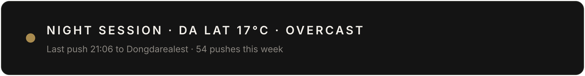
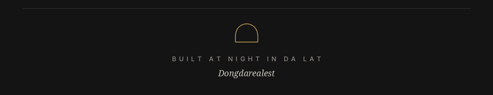

### Recent activity

<!--ACTIVITY:START-->
- Pushed 1 commit to [Dongdarealest](https://github.com/Dongdarealest/Dongdarealest) · 21/11
- Pushed 1 commit to [Clock](https://github.com/Dongdarealest/Clock) · 21/11
- Created branch in [Download-Video-Image-PDF](https://github.com/Dongdarealest/Download-Video-Image-PDF) · 21/11
- Created branch in [tubeeq-api](https://github.com/Dongdarealest/tubeeq-api) · 21/11
- Pushed 1 commit to [tubeeq-api](https://github.com/Dongdarealest/tubeeq-api) · 21/11
<!--ACTIVITY:END-->

<a href="https://dongdarealest.github.io/TubeEQ/">TubeEQ</a> &nbsp;·&nbsp; <a href="https://dongdarealest.github.io/sai-dau-sua-do/">Sai Đâu Sửa Đó</a>

