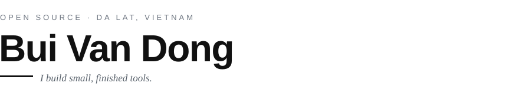
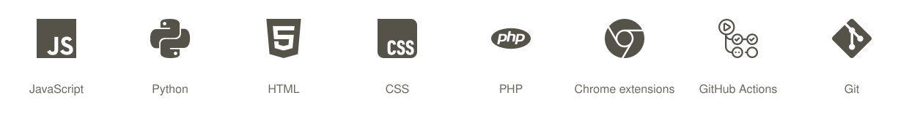
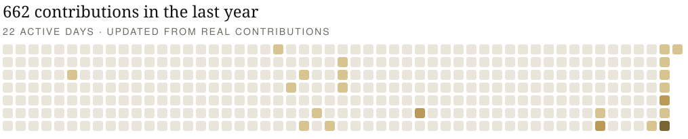

<picture>
  <source media="(prefers-color-scheme: dark)" srcset="header-dark.svg" />
  <source media="(prefers-color-scheme: light)" srcset="header-light.svg" />
  
</picture>

Independent developer building open source tools for real users: browser extensions, learning platforms and AI tooling. Everything I ship is open source, and finished before it is announced.

## Selected work

**[SkillPort](https://github.com/Dongdarealest/skillport)** · Write a skill once, run it on every AI. Converts a Claude `SKILL.md` into ready to use packages for Muse, Cursor, Codex and ChatGPT. [Live demo](https://dongdarealest.github.io/skillport/)

**[TubeEQ](https://github.com/Dongdarealest/TubeEQ)** · Hear YouTube right. A free 10 band equalizer for YouTube with per channel presets and shareable preset codes.

**[Sai Đâu Sửa Đó](https://github.com/Dongdarealest/sai-dau-sua-do)** · An English learning project that fixes one common Vietnamese mistake a day, with a learning site, an open API and a community.

**[GitHub Profile Studio](https://github.com/Dongdarealest/github-profile-studio)** · Make your GitHub profile beautiful in 60 seconds. Ten themes, thirty live blocks, one username.

**[DONGUNLOCK](https://github.com/Dongdarealest/DONGUNLOCK)** · Shadowrocket modules that remove ads and unlock premium features in the apps I use every day.

## Working tools

<picture>
  <source media="(prefers-color-scheme: dark)" srcset="tools-dark.svg" />
  <source media="(prefers-color-scheme: light)" srcset="tools-light.svg" />
  
</picture>

## The last year

<picture>
  <source media="(prefers-color-scheme: dark)" srcset="contrib-dark.svg" />
  <source media="(prefers-color-scheme: light)" srcset="contrib-light.svg" />
  
</picture>

## Elsewhere

[TubeEQ](https://dongdarealest.github.io/TubeEQ/) · [Sai Đâu Sửa Đó](https://dongdarealest.github.io/sai-dau-sua-do/) · [SkillPort demo](https://dongdarealest.github.io/skillport/) · [Ko-fi](https://ko-fi.com/dongvan)

Da Lat, Vietnam · Building in the open since 2022
