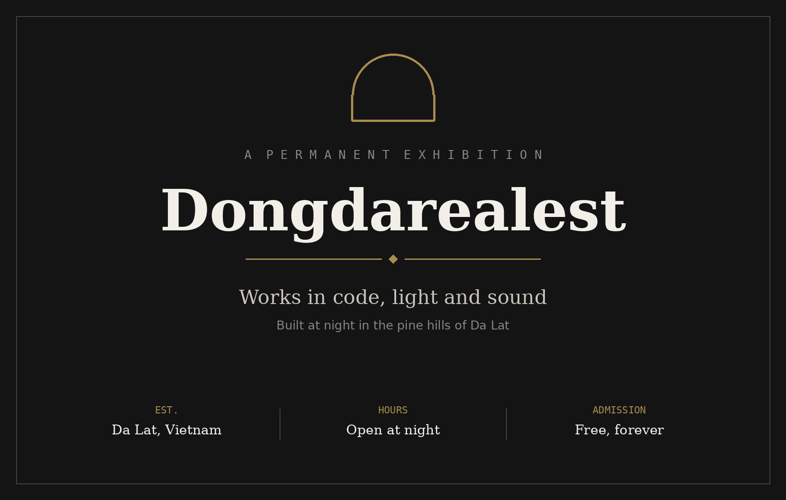
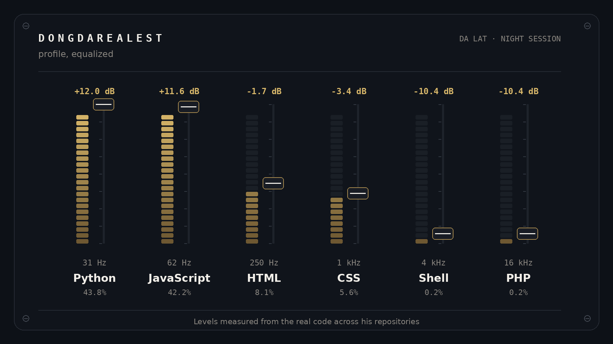
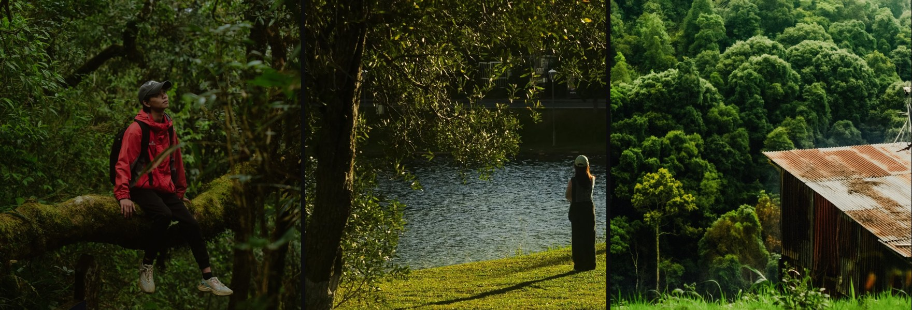

<!--STATUS:START-->

Da Lat now: 16.6°C, partly cloudy · Last push 20:21 to Clock · Currently building TubeEQ and Sai Đâu Sửa Đó

<!--STATUS:END-->

Da Lat, through his lens · @dongdilac

### The rooms

**Phòng 01 · [TubeEQ](https://github.com/Dongdarealest/TubeEQ)**
Hear YouTube right. A 10 band equalizer with presets shared by short code, tuned by ear.

**Phòng 02 · [Sai Đâu Sửa Đó](https://github.com/Dongdarealest/sai-dau-sua-do)**
An English learning library for Vietnamese speakers. Every lesson begins with a mistake worth fixing.

**Phòng 03 · [DONGUNLOCK](https://github.com/Dongdarealest/DONGUNLOCK)**
Shadowrocket modules for a quieter phone: YouTube without ads, apps unlocked.

**Phòng 04 · [tubeeq-api](https://github.com/Dongdarealest/tubeeq-api)**
The small engine room behind TubeEQ: counters, presets and versions.

### 👉 Find me on the web
🌎 https://dongdarealest.github.io/TubeEQ/

📚 [Sai Đâu Sửa Đó](https://dongdarealest.github.io/sai-dau-sua-do/)

