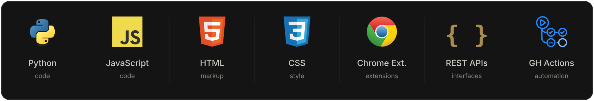
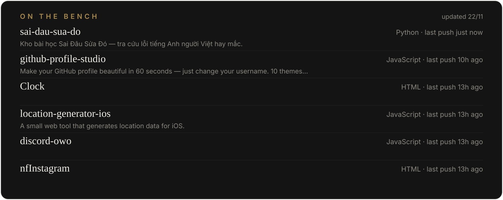

I build small, finished tools: a YouTube equalizer people actually keep installed, an English learning page that fixes one Vietnamese mistake a day, and an open-source studio that makes any GitHub profile beautiful in a minute. Everything below is generated from my real repositories and updates itself.

## Featured works

<picture>
  <source media="(prefers-color-scheme: dark)" srcset="https://raw.githubusercontent.com/Dongdarealest/Dongdarealest/output/github-snake-dark.svg" />
  <source media="(prefers-color-scheme: light)" srcset="https://raw.githubusercontent.com/Dongdarealest/Dongdarealest/output/github-snake.svg" />
  
</picture>

### Recent activity

<!--ACTIVITY:START-->
- Pushed 1 commit to [Dongdarealest](https://github.com/Dongdarealest/Dongdarealest) · 21/11
- Pushed 1 commit to [Clock](https://github.com/Dongdarealest/Clock) · 21/11
- Created branch in [Download-Video-Image-PDF](https://github.com/Dongdarealest/Download-Video-Image-PDF) · 21/11
- Created branch in [tubeeq-api](https://github.com/Dongdarealest/tubeeq-api) · 21/11
- Pushed 1 commit to [tubeeq-api](https://github.com/Dongdarealest/tubeeq-api) · 21/11
<!--ACTIVITY:END-->

<b>Full metrics dashboard</b> — the long version, one click away

<a href="https://dongdarealest.github.io/TubeEQ/">TubeEQ</a> &nbsp;·&nbsp; <a href="https://dongdarealest.github.io/sai-dau-sua-do/">Sai Đâu Sửa Đó</a> &nbsp;·&nbsp; <a href="https://github.com/Dongdarealest/github-profile-studio">Profile Studio</a> &nbsp;·&nbsp; <a href="https://ko-fi.com/dongvan">Ko-fi</a>

